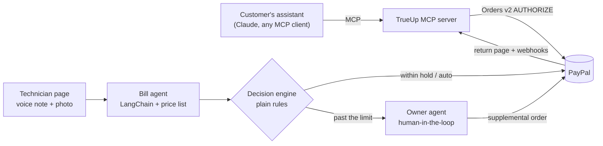

# TrueUp

**Your AI booked the plumber. TrueUp settles the real bill, with PayPal.**

AI assistants can now book services for people. But the price of a repair is rarely known until someone opens the cabinet: a $60 plumber visit becomes $111 when the faucet cartridge turns out to be cracked. Today's agent checkouts charge one fixed amount agreed at booking, so they have no answer when the price changes on site.

TrueUp is the missing piece. It holds the quoted amount with PayPal, turns the technician's voice note into priced line items, and settles the final bill inside the limits the customer agreed to:

| Final bill on a $60 hold | What TrueUp does |
|---|---|
| Job cancelled | Releases the hold; the customer pays nothing |
| $40 (less than booked) | Charges $40; the rest of the hold is released |
| $66 (within PayPal's limit and the customer's rule) | Charges automatically, no new approval |
| $111 (past the limit) | The owner approves, then the customer approves the extra $51 at PayPal |

The automatic limit is PayPal's own: an authorization can be captured up to **115% of the authorized amount, at most $75 more**. TrueUp turns that rule, plus the customer's own spending rule, into a decision engine.

- **Live demo:** https://trueup-gi6e.onrender.com (PayPal sandbox; the free instance may take ~50 s to wake up)
- **MCP server:** `https://trueup-gi6e.onrender.com/mcp` (add it to Claude or any MCP client as a custom connector)
- **Video (2:20):** https://youtu.be/orMGrZlgmQk

## How it works



1. **Book.** The customer's assistant calls `book_visit` on TrueUp's MCP server. TrueUp asks the customer (MCP elicitation) how extra costs should be handled, creates a PayPal order with `intent=AUTHORIZE` for the visit price, and returns the PayPal approval link. The hash of the customer's spending rule travels in the order's `custom_id`.
2. **Report.** The technician records a voice note and takes a photo on `/tech`. The bill agent transcribes it, searches the price list, and returns structured line items. **The AI picks items; prices come from the price list, never from the model.**
3. **Decide.** A deterministic decision engine compares the bill with the hold, PayPal's 115% / +$75 limit and the customer's rule (percent or dollar limit, always-ask categories, expiry).
4. **Settle.** Captures on the original authorization (partial or over-capture), a void, or, past the limit, an owner review (`/owner`) followed by an itemized supplemental order the customer approves at PayPal. The receipt (`/jobs/{id}`) shows every item, the reasons, the photo, the rule's fingerprint, the PayPal ids and a timeline.

## PayPal integration

| PayPal API | Endpoint | Used for |
|---|---|---|
| OAuth 2.0 | `POST /v1/oauth2/token` | Access token, cached until expiry |
| Orders v2 | `POST /v2/checkout/orders` (`intent=AUTHORIZE`) | The booking hold, with `custom_id = job + rule hash` |
| Orders v2 | `POST /v2/checkout/orders/{id}/authorize` | Place the hold after the customer approves |
| Orders v2 | `POST /v2/checkout/orders` (`intent=CAPTURE`, itemized) | Supplemental order for a price change past the limit |
| Orders v2 | `GET /v2/checkout/orders/{id}`, `POST .../capture` | Check approval; capture the supplemental order |
| Payments v2 | `POST /v2/payments/authorizations/{id}/capture` | Capture less than, equal to, or up to 115% of the hold |
| Payments v2 | `POST /v2/payments/authorizations/{id}/void` | Cancelled job: release the hold |
| Payments v2 | `POST /v2/payments/authorizations/{id}/reauthorize` | Holds older than the 3-day honor period |
| Webhooks | `POST /v1/notifications/verify-webhook-signature` | Verify every webhook before acting on it |

Details that make it safe with real money:
- Money is `Decimal`, never float. Every POST carries a `PayPal-Request-Id`; captures use **fixed keys per job** (`job-123:hold-capture`), so a retry returns PayPal's original result instead of charging twice.
- A cross-process claim in the database makes settlement safe when the return page, a webhook and the customer's assistant all try to finish the same payment at once.
- Captures ask for `Prefer: return=representation` so receipts carry full amounts. PayPal errors become typed errors keyed on `issue` (for example `MAX_CAPTURE_AMOUNT_EXCEEDED`) with the `debug_id` logged.
- Verified in the sandbox: capture $69 on a $60 authorization (allowed), $20 then $30 (allowed), $120 (rejected by PayPal), void (allowed).

## AI

| Component | Built with | Job |
|---|---|---|
| Bill agent | LangChain 1.x `create_agent`, structured output `DraftBill`, tools `search_price_list` / `get_price_item` | Voice note + photo to price-list items with reasons |
| Price guard | Custom middleware (`after_model`) | Rejects invented SKUs or absurd quantities and sends the model back to fix them |
| Audit log | Custom middleware (`wrap_tool_call`, `wrap_model_call`) | Records every tool and model call as evidence |
| Privacy and reliability | `PIIMiddleware` (email, phone, street address), `ModelRetryMiddleware`, `ModelFallbackMiddleware`, model and tool call limits | Customer details never reach the model; a backup model takes over on errors |
| Owner agent | `HumanInTheLoopMiddleware` + SQLite checkpointer | Drafts the message to the customer, then pauses until the owner approves, edits or rejects. Its tool has no amount argument: the amount comes from the decision engine |
| Ledger agent | Read-only tools over the job store | The owner asks "what did on-site changes add this week?"; numbers come from code |
| Speech to text | OpenAI transcription (`gpt-4o-mini-transcribe`, fallback `whisper-1`) | Technician voice notes |

## MCP server

FastMCP, mounted at `/mcp` (streamable HTTP) and runnable over stdio for Claude Desktop.

- **Tools:** `list_services`, `get_slots`, `book_visit`, `wait_for_paypal_approval`, `confirm_booking`, `get_job_status`, `view_price_change`, `approve_price_change`, `decline_price_change`, `cancel_booking`
- **Resources:** `trueup://services`, `trueup://price-list`, template `trueup://jobs/{job_id}/spending-rule`
- **Prompt:** `book_a_service`
- **Elicitation:** the customer chooses their spending rule, and confirms or declines a price change, directly rather than through the assistant
- **Sampling** (optional; deprecated in the 2026-07-28 spec): the customer's own assistant writes the plain-language explanation of a price change
- **Progress:** live updates while waiting for PayPal approval and while capturing
- Works on both the 2026-07-28 protocol (input-required round trips) and 2025-11-25 clients, with fallbacks when a client lacks a capability. Read-only tools carry `readOnlyHint`; errors are clean tool errors.
- The server instructions tell assistants never to approve a price change without the user's explicit yes.

## Run it locally

Requires Python 3.11+, a PayPal developer account with **US** sandbox business and personal accounts, and an OpenAI key.

```bash
pip install -r requirements.txt
cp .env.example .env          # fill in PAYPAL_CLIENT_ID, PAYPAL_CLIENT_SECRET, OPENAI_API_KEY
uvicorn app.main:build_web --factory --port 8000
```

- Pages: `http://127.0.0.1:8000` (technician `/tech` and owner `/owner` sign in as `owner` or `tech` with `STAFF_PASSWORD`)
- Claude Desktop (stdio): see `scripts/claude_desktop_config.example.json`
- Terminal tools: `python scripts/ops.py jobs | report | owner | receipt`
- Live sandbox check of all three paths: `python scripts/sandbox_paths.py`

## Tests

```bash
pytest
```

122 tests, no network needed: a stateful fake of the PayPal endpoints (including request-id idempotency), a scripted chat model for the agents, the full job lifecycle across processes, concurrent settlement, MCP tools through a real MCP client on both protocol versions, and the web pages.

## Project layout

```
app/paypal/      PayPal client, orders, payments, webhooks, Decimal money
app/engine/      spending rule (mandate + SHA-256), decide(), settle()
app/agents/      bill agent, owner agent (HITL), ledger agent, middleware, price list
app/mcp_server/  FastMCP server, elicitation / sampling / progress helpers
app/service.py   job lifecycle; app/store.py SQLite job store + timeline
app/main.py      FastAPI: pages, PayPal return, webhooks, /mcp
data/            price list and service catalog
tests/           122 tests
```

## Limits and next steps

- Sandbox only. The free Render instance keeps its SQLite file on an ephemeral disk, so jobs reset on redeploy; production would use Postgres.
- The public `/mcp` endpoint has no authentication in this demo; production would add OAuth for the customer's assistant.
- Demo mode accepts technician reports before the booked slot and offers an "ASAP" slot so the whole flow fits in a few minutes.
- Next: vaulted payment methods for repeat customers, and Payouts for technician commissions.

## License

MIT
